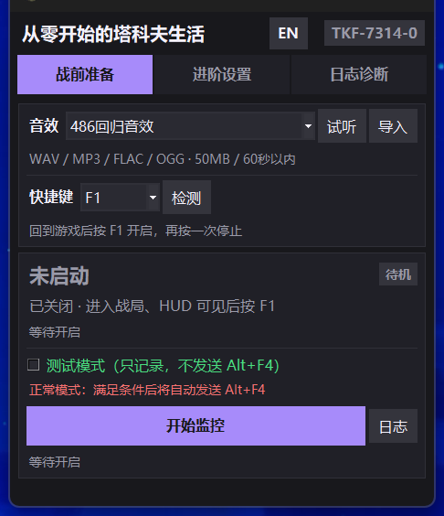
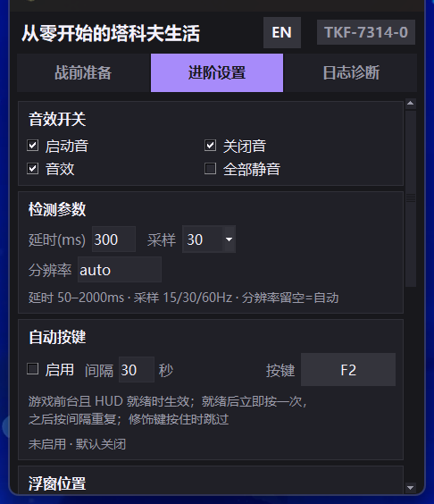
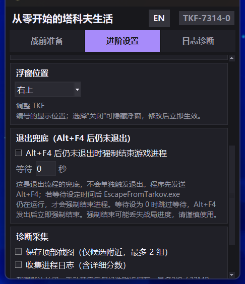
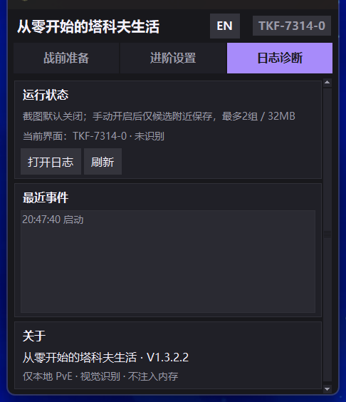
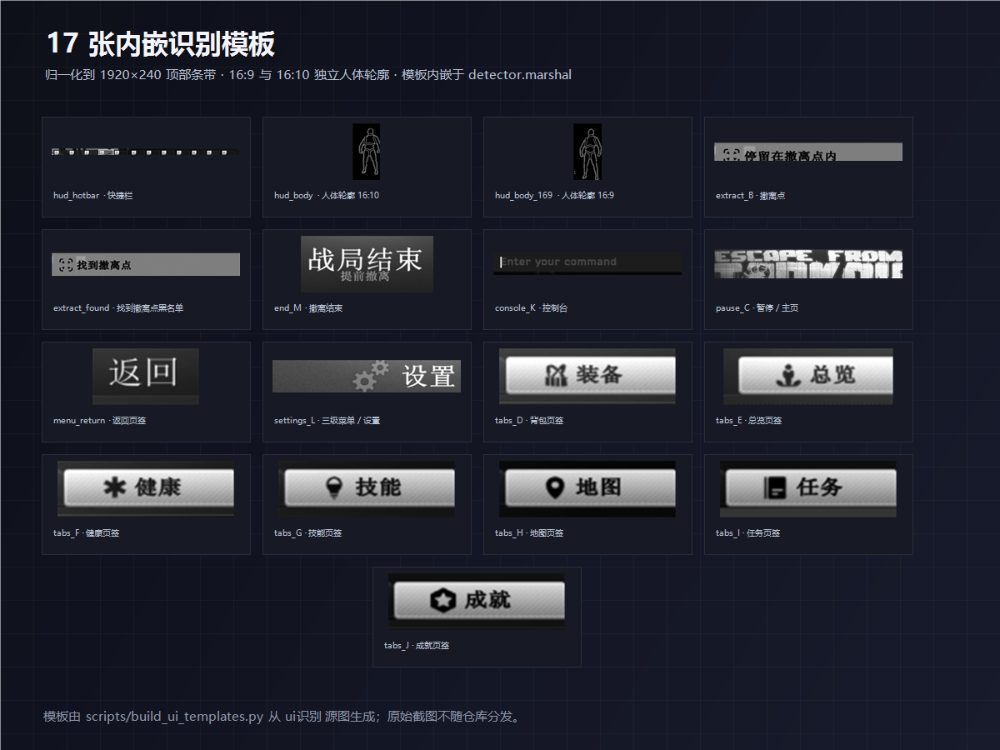

<div align="center">
  
</div>

<h1 align="center">从零开始的塔科夫生活</h1>

<p align="center">
  <strong>Escape from Tarkov 界面识别与监控辅助 · Windows 桌面工具</strong>
</p>

<p align="center">
  
  
  
  
</p>

> 只截取游戏画面顶部条带，用模板匹配判断当前界面，在屏幕角落显示识别结果。  
> 不读取游戏内存、不注入进程、不修改游戏文件，也不提供透视、自瞄、物资显示或雷达功能。

当前正式版：**V1.3.2.2**（2026-10-26）。本仓库由 GitHub 账号 `YuuKA8447` 托管；旧账号 `youxia8447-oss` 已停用，更早版本未迁移，详见 [CHANGELOG.md](CHANGELOG.md)。

---

## 下载

前往 [Releases](https://github.com/YuuKA8447/YuuKA8447-tarkov-life/releases/latest) 下载最新正式版 V1.3.2.2。

| 文件 | 说明 |
| --- | --- |
| [`Tarkov-Life-V1.3.2.2.zip`](https://github.com/YuuKA8447/YuuKA8447-tarkov-life/releases/download/v1.3.2.2/Tarkov-Life-V1.3.2.2.zip) | 推荐。解压后含中文命名 EXE、`icons` 目录、使用说明、更新说明、项目说明与 SHA256 |
| [`Tarkov-Life-V1.3.2.2.exe`](https://github.com/YuuKA8447/YuuKA8447-tarkov-life/releases/download/v1.3.2.2/Tarkov-Life-V1.3.2.2.exe) | 单文件免安装版本 |
| [`Tarkov-Life-V1.3.2.2.sha256`](https://github.com/YuuKA8447/YuuKA8447-tarkov-life/releases/download/v1.3.2.2/Tarkov-Life-V1.3.2.2.sha256) | ZIP 与 EXE 的 SHA256 校验文件 |

EXE 59,672,615 字节 · ZIP 59,175,235 字节。下载后可在同一目录执行 `sha256sum -c Tarkov-Life-V1.3.2.2.sha256` 校验。

```text
EXE  F6F733484E962B664FF147710B3EAF5C1816986A572AEDFE573AC66F4EE61FC8
ZIP  42C063191B6900379061F368130C33344905987ED90E7FA552B3947132C18A1B
```

系统要求：Windows 10 / 11 64 位；建议游戏使用窗口化或无边框窗口，保持 16:9 或 16:10。

---

## 界面

| 战前准备 | 进阶设置 |
| --- | --- |
|  |  |
| 音效、快捷键、监控状态与启动入口 | 音效开关、检测参数、自动按键与检测延迟 |

| 进阶设置 · 下半 | 日志诊断 |
| --- | --- |
|  |  |
| 浮窗位置、退出兜底与诊断采集 | 运行状态、最近事件与版本信息 |

<p align="center">
  
</p>

<p align="center"><sub>常驻识别徽标：<code>TKF-7314-0</code> / <code>TKF-7314-A</code> … <code>TKF-7314-Z</code></sub></p>

---

## 核心能力

| 能力 | 说明 |
| --- | --- |
| **A–L 界面识别** | 17 张归一化模板内嵌在 `detector.marshal`，覆盖战斗 HUD、菜单、设置、撤离与黑屏过渡；运行时不再读取界面图片。 |
| **F1 一键监控** | 默认快捷键 F1，可在界面中修改；检测模式默认不开启，避免误触发。 |
| **撤离状态机** | 识别到 `B` 时播放关闭提示音并暂停 Alt+F4，继续检测；`Z` 黑屏与 `M` 撤离结束静音；`M` 后 3 秒停止监控并显示 `0`。 |
| **常驻识别徽标** | 默认在主屏右上角显示 `TKF-7314-<编号>`，鼠标穿透、不占任务栏；支持关闭与 6 个锚点。 |
| **退出兜底** | 先发送 Alt+F4，等待 0–30 秒仍未退出时，只强制结束 `EscapeFromTarkov.exe`。 |
| **主题图标同步** | 486、杀手皇后、宇智波鼬三套退出音效；切换后窗口、托盘图标与音效一起切换。`icons\` 目录需与 EXE 同级。 |

---

## 快速上手

1. 解压 ZIP，保持 `icons` 文件夹与 EXE 同级，双击 `从零开始的塔科夫生活_V1.3.2.2.exe`。
2. 启动时如询问管理员权限，按需选择；发送 Alt+F4 与自动按键需要管理员权限。
3. 进入游戏后按 **F1** 开启或关闭监控。
4. 屏幕右上角会显示当前界面编号，例如 `TKF-7314-0`、`TKF-7314-A`、`TKF-7314-Z`。
5. 撤离过场依次经过 `B` 绿色横幅、`Z` 黑屏与 `M` 撤离结束；识别到 `M` 后 3 秒停止监控。
6. “退出兜底”默认关闭；启用后等待 0 秒会立即强制结束游戏进程，可能丢失战局进度。
7. 浮窗位置在“进阶设置 → 浮窗位置”中调整：关闭、居中上、居中下、左上、左下、右上、右下。

---

## 识别编号

| 编号 | 页面 | 编号 | 页面 |
| --- | --- | --- | --- |
| `A` | 战斗 HUD | `G` | 技能 |
| `B` | 撤离点 | `H` | 地图 |
| `C` | 游戏主页 / 暂停 | `I` | 任务 |
| `D` | 背包 | `J` | 成就 |
| `E` | 总览 | `K` | 控制台 |
| `F` | 健康 | `L` | 三级菜单 / 设置 |

兜底：`U` 未知菜单 / 返回页签；`Z` 黑屏加载 / 撤离过渡；`M` 撤离结束 / 战局结束；`0` 未识别。

---

## 识别原理



1. 只截取游戏画面顶部条带：`strip_h = round(full_h * 240 / 1080)`。
2. 统一缩放到 `1920 × 240`，转换为灰度 / Canny 边缘图。
3. 使用 17 张模板做灰度或边缘匹配，判定顺序：撤离结束 `M` → 黑屏 `Z` → 撤离 `B` → 强 HUD `A` → 菜单 `K/L/页签/U/C` → 弱 HUD 回落 `A` → `0`。
4. 战斗 HUD 分数：`0.70 × 人体轮廓边缘支持 + 0.30 × 快捷栏灰度匹配`；16:9 与 16:10 使用独立人体轮廓模板。
5. `end_M` 使用 X/Y 独立多尺度匹配；阈值 `0.78`，81 张非 M 素材最高误匹配 `0.488`。
6. 41 张源图全帧与顶部条带回归全部通过；单帧平均约 46.4 ms，最大 75.0 ms。

完整阈值、模板裁剪框与回归数据见 [项目说明.md](项目说明.md)。

---

## 安全边界

- **只截屏**：仅读取屏幕顶部条带，不读取游戏内存、不注入进程、不修改游戏文件。
- **强杀限定**：强制结束前校验进程句柄与 token，只匹配 `EscapeFromTarkov.exe`，不会结束其他进程。
- **无作弊功能**：不提供透视、自瞄、物资提示、雷达或任何游戏内信息增强。
- **风险提示**：Alt+F4、自动按键与强制结束可能违反游戏服务条款或导致战局进度丢失；请在了解风险后自行决定是否使用。本项目与 BattlEye、Battlestate Games 无关联。

---

## 从源码构建

仓库包含界面源码、识别模块、构建脚本、17 张模板与三套主题图标。完整构建还需要：

- Windows 10 / 11 64 位
- Python 3.11 x64（`一键构建.bat` 默认使用 `tools\py311\python.exe`）
- `numpy`、`opencv-python-headless`
- PyInstaller 基底 `base\base_branded.exe`
- 原始截图 `ui识别\`（因体积与隐私原因未随仓库分发，目录规范见 [ui识别/README.md](ui识别/README.md)）

准备好上述依赖后，双击 `一键构建.bat`，或按脚本顺序执行 16 步构建。使用系统 Python 时，把 BAT 中的 `tools\py311\python.exe` 替换为你的 `python.exe`。构建链包含 41 张源图识别回归与撤离状态机测试，任一失败都会中止。

> 当前源码中的版本常量仍为 `V1.2.0.3`，直接构建会得到该版本；发布用的 `V1.3.2.2` 是在构建完成后按归档目录做版本号归一化生成，程序功能不变。

---

## 版本与更新

- **V1.3.2.2** — 当前正式版。由原 `V1.2.0.3` 按 `MAJOR.MINOR.PATCH.BUILD` 四段版本归一化而来，PE FileVersion / ProductVersion、界面关于行、EXE、ZIP 与校验文件统一为 `1.3.2.2`；功能、识别模板、音效与图标不变。
- 完整变更记录见 [CHANGELOG.md](CHANGELOG.md)。
- 旧仓库的 `v1.1.1.0`、`v1.2.0.1` 两个 Release 未迁移到新仓库；历史包与校验值保留在本地归档，本仓库只发布 `v1.3.2.2`。

---

## 许可证

[MIT License](LICENSE)

第三方组件（Python、PyInstaller、NumPy、OpenCV、Pillow 等）遵循各自许可证。发布包内已包含其运行时组件。

仓库内的图标与音效素材可能来自第三方作品，版权归各自权利人所有，MIT 许可证不覆盖这些素材。如权利人提出异议，将移除相关素材。
