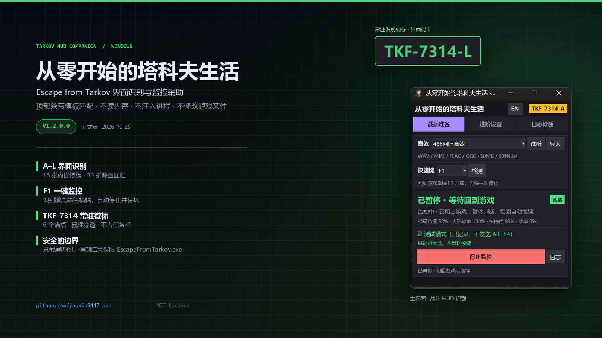
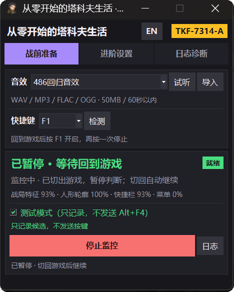
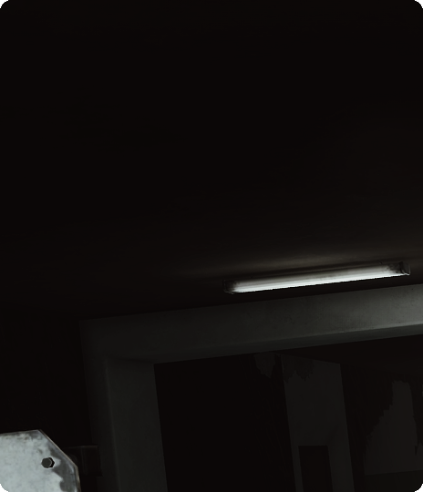
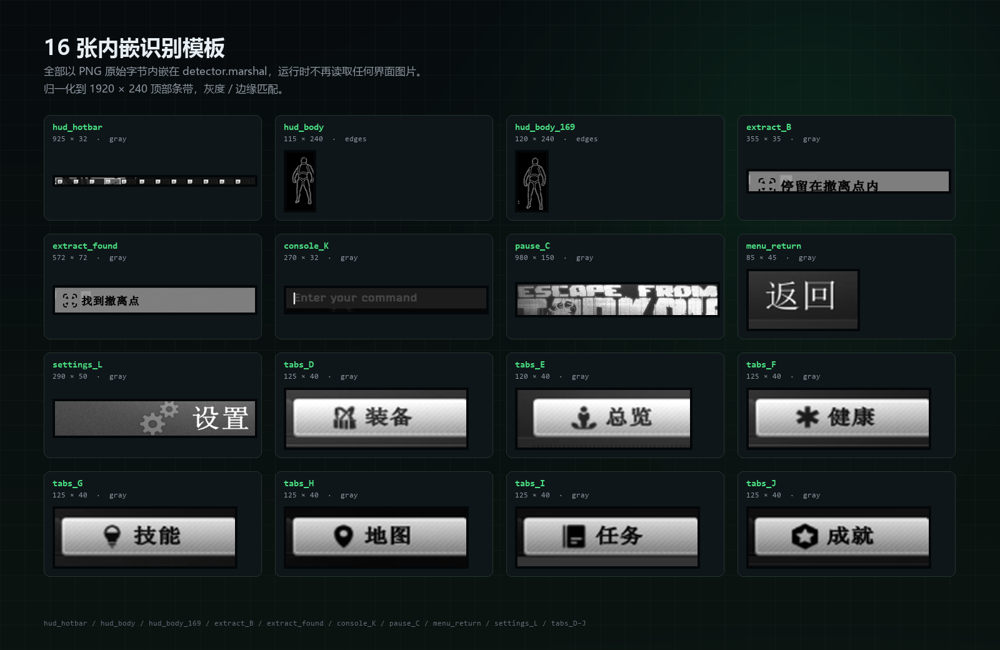

# 从零开始的塔科夫生活

**Escape from Tarkov 界面识别与监控辅助 · Windows 桌面工具**




## 这是什么

一个运行在 Windows 上的塔科夫界面识别工具。它只截取游戏画面**顶部条带**，用模板匹配判断当前处于哪个界面（战局 HUD、菜单、设置、撤离与黑屏过渡等），并在屏幕角落显示识别结果。识别到撤离点绿色横幅后会暂停 Alt+F4 并继续检测；识别到撤离结束页后再等待 3 秒停止监控。

程序不读取游戏内存、不注入进程、不修改游戏文件，也不提供透视、自瞄、物资显示或雷达等功能。

当前版本：**V1.3.2.2**（2026-10-26，正式版；由原 `V1.2.0.3` 按归档 `MAJOR.MINOR.PATCH.BUILD` 四段版本归一化而来，功能与 V1.2.0.2 正式版一致，仅版本号、文件名与校验值变化）

> 仓库迁移：本仓库现由 GitHub 账号 `YuuKA8447` 托管。旧账号 `youxia8447-oss` 已被停用，原仓库与 Release 不再可用；新仓库仅重新发布 V1.3.2.2，更早版本保留在本地归档，详见 [CHANGELOG.md](CHANGELOG.md)。

## 功能

- **A–L 界面识别**：17 张归一化模板内嵌在 `detector.marshal`，运行时不再读取界面图片；16:9 与 16:10 分别使用独立人体轮廓模板。
- **F1 一键监控**：默认快捷键 F1，可在界面中修改。
- **撤离状态机**：识别到 `B` 时播放一次关闭提示音并暂停 Alt+F4，继续检测；黑屏 `Z` 与撤离结束 `M` 均不播放音效，`M` 后等待 3 秒停止监控并显示 `0`，此时只播放一次关闭提示音；若 `B` 消失后重新稳定出现战斗 HUD `A`（强证据持续 0.5 秒，且距 B 消失至少 5 秒），播放开启提示音并恢复 Alt+F4。成功撤离读秒末期短暂出现的 `A`（约 2 秒）不会误触发恢复。状态栏不会再为撤离状态叠加关闭音。
- **主题图标同步**：三套退出音效分别对应 486、杀手皇后、宇智波鼬图标；切换后窗口大/小图标与托盘图标一起切换。发布包内的 `icons\` 目录需与 EXE 保持同级。
- **常驻识别徽标**：默认显示在主屏幕右上角，可显示 `TKF-7314-0` / `TKF-7314-A` … `TKF-7314-Z`；支持关闭与 6 个锚点，鼠标穿透、不占任务栏。
- **退出兜底**：先发送 Alt+F4，等待时间可设 0–30 秒；仍未退出时强制结束 `EscapeFromTarkov.exe`。仅作用于该进程。
- **自动按键**：默认关闭；启用后仅在游戏前台且 HUD 就绪时发送。
- **诊断日志**：记录识别结果、命中分数与运行事件，便于排查。

## 界面预览

| 主界面 | 进阶设置 |
| --- | --- |
|  |  |

常驻识别徽标（识别到设置页时）：


## 下载

前往 [Releases](https://github.com/YuuKA8447/tarkov-life/releases/latest) 下载最新正式版 V1.3.2.2：

| 文件 | 说明 |
| --- | --- |
| [`Tarkov-Life-V1.3.2.2.zip`](https://github.com/YuuKA8447/tarkov-life/releases/download/v1.3.2.2/Tarkov-Life-V1.3.2.2.zip) | 推荐。解压后含中文命名的 EXE、`icons` 目录、使用说明、更新说明、项目说明与 SHA256 |
| [`Tarkov-Life-V1.3.2.2.exe`](https://github.com/YuuKA8447/tarkov-life/releases/download/v1.3.2.2/Tarkov-Life-V1.3.2.2.exe) | 单文件免安装版本 |
| [`Tarkov-Life-V1.3.2.2.sha256`](https://github.com/YuuKA8447/tarkov-life/releases/download/v1.3.2.2/Tarkov-Life-V1.3.2.2.sha256) | ZIP 与 EXE 的 SHA256 校验文件 |

GitHub Release 资产使用 ASCII 文件名；Release 页面上的中文 label 与解压后的文件保持原中文名。

下载后可在同一目录执行 `sha256sum -c Tarkov-Life-V1.3.2.2.sha256` 校验。

V1.3.2.2 EXE SHA256：

```text
F6F733484E962B664FF147710B3EAF5C1816986A572AEDFE573AC66F4EE61FC8
```

V1.3.2.2 ZIP SHA256：

```text
42C063191B6900379061F368130C33344905987ED90E7FA552B3947132C18A1B
```

`icons` 目录必须与 EXE 保持在同一目录；只拷贝 EXE 时，切换退出音效仍可播放，但窗口与托盘图标会回退到默认图标。新仓库仅保留 V1.3.2.2 的 Release；更早版本未迁移，见 [CHANGELOG.md](CHANGELOG.md)。

系统要求：Windows 10 / 11 64 位；建议游戏使用窗口化或无边框窗口，保持 16:9 或 16:10。

## 快速上手

1. 解压 ZIP，保持 `icons` 文件夹与 EXE 同级，双击 `从零开始的塔科夫生活_V1.3.2.2.exe`。
2. 启动时如弹出管理员权限提示，选择“是”。发送 Alt+F4 与自动按键需要管理员权限。
3. 进入游戏后按 **F1** 开启或关闭监控。
4. 屏幕右上角会显示当前界面编号，例如 `TKF-7314-0`、`TKF-7314-A`、`TKF-7314-Z`。
5. 识别到撤离点绿色横幅 `TKF-7314-B` 后，程序播放关闭提示音并暂停 Alt+F4，但继续检测。
6. 撤离过场依次经过黑屏 `TKF-7314-Z` 与撤离结束 `TKF-7314-M`；识别到 `M` 后不再发送 Alt+F4，3 秒后停止监控并显示 `TKF-7314-0`，同时再播放一次关闭提示音。
7. 若只是路过撤离点（`B` 消失且未黑屏），随后重新识别到战斗 HUD `TKF-7314-A`，程序播放开启提示音并恢复 Alt+F4。
8. “退出兜底”默认关闭。启用后它是 Alt+F4 之后的兜底：等待设为 0 秒时会立即强制结束游戏进程。此操作可能丢失战局进度，请确认后再使用。
9. 浮窗位置在“进阶设置 → 浮窗位置”中调整，顺序为：关闭、居中上、居中下、左上、左下、右上、右下。选择“关闭”会隐藏浮窗；在下拉框上滚动鼠标不会误切换选项，也不会带动设置页滚动。

## 界面编号

| 编号 | 页面 | 编号 | 页面 |
| --- | --- | --- | --- |
| `A` | 战斗 HUD | `G` | 技能 |
| `B` | 撤离点 | `H` | 地图 |
| `C` | 游戏主页 / 暂停 | `I` | 任务 |
| `D` | 背包 | `J` | 成就 |
| `E` | 总览 | `K` | 控制台 |
| `F` | 健康 | `L` | 三级菜单 / 设置 |

兜底编号：`U` 未知菜单 / 返回页签；`Z` 黑屏加载 / 撤离过渡；`M` 撤离结束 / 战局结束；`0` 未识别。

`M` 页面按“战局结束 / 提前撤离”标题模板优先匹配；黑屏 `Z` 使用亮度阈值兜底。两者都只在顶部条带匹配，不读取游戏数据。

## 识别原理



1. 只截取游戏画面顶部条带：`strip_h = round(full_h * 240 / 1080)`。
2. 统一缩放到 `1920 × 240`，转换为灰度 / Canny 边缘图。
3. 使用 17 张模板做灰度或边缘匹配，按优先级判定：撤离结束 `M` → 黑屏 `Z` → 撤离 `B` → 强 HUD `A` → 菜单 `K/L/页签/U/C` → 弱 HUD 回落 `A` → `0`。
4. 战斗 HUD 分数：`0.70 × 人体轮廓边缘支持 + 0.30 × 快捷栏灰度匹配`；人体轮廓取 16:10 `hud_body` 与 16:9 `hud_body_169` 的最大值。
5. `end_M` 模板使用 X/Y 独立多尺度匹配，适配 16:10 与 16:9 归一化后的宽高比差异；阈值 `0.78`，81 张非 M 素材最高误匹配 `0.488`。
6. 单帧平均耗时约 46.4 ms（41 张源图回归，最大 75.0 ms）。

完整阈值、模板裁剪框与回归数据见 [项目说明.md](项目说明.md)。

## 安全边界

- **只截屏**：仅读取屏幕顶部条带，不读取游戏内存、不注入进程、不修改游戏文件。
- **强杀限定**：强制结束前校验进程句柄与 token，只匹配 `EscapeFromTarkov.exe`，不会结束其他进程。
- **无作弊功能**：不提供透视、自瞄、物资提示、雷达或任何游戏内信息增强。
- **风险提示**：Alt+F4、自动按键、强制结束可能违反游戏服务条款或导致战局进度丢失；请在了解风险后自行决定是否使用。本项目与 BattlEye、Battlestate Games 无关联。

## 已知限制

1. 源图没有可用的倒计时数字模板，`timer_state` 固定为 `unknown`；撤离保护依赖绿色横幅本身。
2. 识别依赖 UI 位置与缩放。大幅修改 HUD 缩放、分辨率或界面布局后，需要重新生成模板。
3. 常驻徽标固定在主屏幕，不跟随游戏窗口；独占全屏可能遮挡置顶窗口。
4. 模板按 16:10 与 2560×1440 实机截图分别归一化生成；16:9 使用独立人体轮廓模板。大幅修改 HUD 缩放或界面布局后仍需重新生成。
5. 撤离结束 `M` 只匹配顶部标题区域；若游戏更新改动该页面排版，需要重新生成模板。
6. 配置写入 `%LOCALAPPDATA%\TarkovHUDMonitor\settings.json`；未修改设置时不一定生成。
7. 三套主题 ICO 不内嵌进 EXE，而是放在发布包的 `icons\` 目录。缺少该目录时窗口与托盘图标回退到默认图标，音效、识别与撤离流程不受影响。

## 从源码构建

仓库包含界面源码、识别模块、构建脚本与 17 张模板。完整构建还需要：

- Windows 10 / 11 64 位
- Python 3.11 x64（`一键构建.bat` 默认使用 `tools\py311\python.exe`）
- `numpy`、`opencv-python-headless`
- PyInstaller 基底 `base\base_branded.exe`
- 原始截图 `ui识别\`（因体积与隐私原因未随仓库分发）

准备好上述依赖后，双击 `一键构建.bat`，或按脚本顺序执行 16 步构建。使用系统 Python 时，把 BAT 中的 `tools\py311\python.exe` 替换为你的 `python.exe`。构建链包含 41 张源图识别回归与撤离状态机测试，任一失败都会中止。

构建脚本在找不到 `cv2` 时支持 `TARKOV_CV2_SITE` 环境变量，指向包含 `cv2` 的目录。

当前仓库内源码与构建脚本的版本常量仍为 `V1.2.0.3`，直接构建会得到该版本；发布用的 `V1.3.2.2` 是在构建完成后按归档目录做版本号归一化生成，程序功能不变。

### 目录结构

```text
.
├─ assets/
│  ├─ interface/          # 17 张模板 + templates.json
│  ├─ audio/              # 音效源文件
│  └─ icons/              # 三套主题图标源文件
├─ docs/images/           # README 展示图
├─ scripts/               # 模板生成、回归、打包脚本
├─ ui_compact.py          # 界面源码
├─ sound_library.py       # 音效库源码
├─ detector.marshal       # 内嵌模板的识别模块
├─ monitor.marshal        # 监控主逻辑（默认 F1、撤离状态机）
├─ ui_compact.marshal     # 界面模块编译产物
├─ sound_library.marshal  # 音效库编译产物
├─ 一键构建.bat
├─ 项目说明.md            # 完整技术文档
└─ README.md
```

## 版本历史

- **V1.3.2.2** — 正式版（GitHub Release `v1.3.2.2`，当前最新）：由 V1.2.0.3 按归档目录版本归一化，PE FileVersion / ProductVersion、`VS_FIXEDFILEINFO`、界面关于行、EXE、解包目录、ZIP 与校验文件统一为 `1.3.2.2`；功能、识别模板、音效与图标不变，仍与 V1.2.0.2 正式版一致。发布资产为 `Tarkov-Life-V1.3.2.2.zip`（59,175,235 字节）与 `Tarkov-Life-V1.3.2.2.exe`（59,672,615 字节），SHA256 见下载区。
- **V1.2.0.3** — 正式版（已归一化为 V1.3.2.2，不再单独发布）：取消 beta 版本说法，版本号按 `MAJOR.MINOR.PATCH.BUILD` 四段规则重新排位；功能与 V1.2.0.2 正式版一致，仅构建号由 2 递增到 3；界面标题恢复为“正式版”，关于行 `V1.2.0.3`，PE FileVersion / ProductVersion 为 `1.2.0.3`。历史归档已按四段规则重算为 `V1.1.0.0`～`V1.3.2.1`，其中 V1.2.0.2 正式版与临时 `V1.2.0.2beta` 的目录版本分别为 V1.3.2.0、V1.3.2.1；V1.2.0.3 随后按同一口径归一化为 `V1.3.2.2` 并以该版本发布。归档归一化以目录版本为正确版本，归档内 EXE、解包目录、ZIP、PE 版本资源与校验文件全部与目录一致（界面标签与历史引用保留），归一化前的完整备份在 `项目文件历史版本_原始备份_20261026\`。
- **V1.2.0.2beta** — 临时测试版（已被 V1.3.2.2，即原 V1.2.0.3 取代，仅保留归档）：测试模式默认关闭（已明确保存的选择继续沿用）；修复浮窗位置下拉框滚轮误切换选项并带动设置页滚动的问题，音效、快捷键、采样率下拉框同样拦截滚轮；浮窗位置新增“关闭”，顺序为关闭、居中上、居中下、左上、左下、右上、右下，隐藏后不会被置顶刷新重新显示；历史版本统一归档到 `项目文件历史版本\`。此前构建的 V1.2.0.2 正式版已归档到 `项目文件历史版本\V1.3.2.0\`（四段规则重算版本，原版本 V1.2.0.2）。
- **V1.2.0.1** — 正式版：由 V1.2.0.1beta 转正。新增撤离结束 `M` 模板与黑屏 `Z` 界面码；实现 `B → 2 秒 A → Z → M → 3 秒 → 0` 成功撤离流程与 `B → A` 恢复流程；移除 UI 层残留的 B 自动停机逻辑，B 阶段浮窗保持 `TKF-7314-B`；恢复判定延长到 5 秒，修复 B/A 快速往返导致的停止音连响与开启音被盖住，A 约 2 秒转黑不再误恢复；状态栏提示音不再叠加到撤离状态，M 静音、0 只响一次；修复切换退出音效后窗口与托盘图标不变化，发布包新增 `icons\` 三套主题 ICO；41 图回归；17 模板；构建链 16 步；文件名、目录与界面文案统一为正式版。
- **V1.2.0.0** — 正式版：V1.1.0.5beta 经用户游戏内实测通过后转正；识别、界面行为与启动修复保持不变，版本号、文件名与界面文案不再带 `beta`。
- **V1.1.0.5beta** — 以 V1.1.0.5 为基线回滚启动改造；新增 16 张 2560×1440 实图与 16:9 人体轮廓模板；39 张源图回归；UAC 取消保留原窗口，提权 readiness 交接；新增启动日志。
- **V1.1.0.7beta**（已回滚） — 曾修复启动自动关闭与重复启动聚焦。
- **V1.1.0.6beta**（已回滚） — 曾修复显示缩放下的全屏识别。
- **V1.1.0.5** — 恢复自动按键原有行为：HUD A 就绪立即按一次，之后每 30 秒一次。
- **V1.1.0.4** — 撤离点黑名单、退出兜底默认关闭、浮窗六锚点边界修正。
- **V1.1.0.3** — 修复浮窗在无边框窗口化游戏上方不显示。
- **V1.1.0.2** — 修正进阶设置卡片顺序。
- **V1.1.0.1beta** — 进阶设置卡片顺序调整初版（GitHub 历史资产名为 V1.1.0.1，2026-10-26 归一化后重新发布为 `v1.1.1.0`）。
- **V1.1.0.0** — 正式版：仅基于 `ui识别` 源图重写识别器；A–L 编码；设置页 L；常驻徽标与 6 锚点；默认 F1；退出兜底 0 秒；重写构建链。
- **V1.0.0.1** — 管理员提示调整；替换 11 张 UI 模板。
- **V1.0.0.0** — 测试版转正；识别素材替换、包体精简、性能优化。

### GitHub Release 与历史版本对应

新仓库只发布当前正式版 `v1.3.2.2`。旧账号 `youxia8447-oss` 已停用，原 `v1.1.1.0`、`v1.2.0.1` 两个 Release 未迁移，保留在本地归档与 CHANGELOG 记录中。

| GitHub Release | 归档版本 | 原产品版本 | 内容 |
| --- | --- | --- | --- |
| [`v1.3.2.2`](https://github.com/YuuKA8447/tarkov-life/releases/tag/v1.3.2.2) | V1.3.2.2 | V1.2.0.3 | 当前最新正式版；M/Z 撤离状态机、浮窗与图标修复 |

原产品 **V1.2.0.1**（M/Z 撤离状态机首个正式版）归档为 **V1.3.1.0**；原产品 V1.2.0.2 与 V1.2.0.2beta 归档为 V1.3.2.0、V1.3.2.1。这些版本以及旧仓库的 `v1.1.1.0`、`v1.2.0.1` 未在新仓库发布，完整索引见本地 `项目文件历史版本/README.md`。

完整变更见 [CHANGELOG.md](CHANGELOG.md)。

## 许可证

[MIT License](LICENSE)

第三方组件（Python、PyInstaller、NumPy、OpenCV、Pillow 等）遵循各自许可证。发布包内已包含其运行时组件。

仓库内的图标与音效素材可能来自第三方作品，版权归各自权利人所有，MIT 许可证不覆盖这些素材。如权利人提出异议，将移除相关素材。
